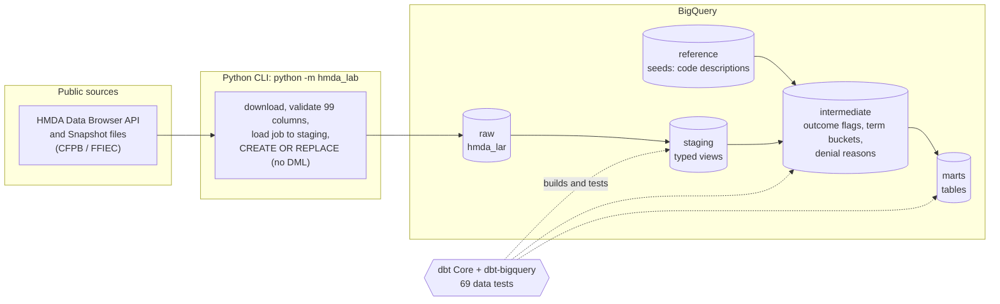

# HMDA Mortgage Ops Lab

A public analytics engineering lab on the U.S. mortgage market, built only on public data:
the **HMDA** loan/application register published by the CFPB/FFIEC. Python loads raw data into
BigQuery; dbt types, tests and models it into marts.

> **Status: phase 1.5, verified on BigQuery (Delaware 2025, 17 Nov 2026).** Python
> ingestion loaded 55,183 HMDA rows into a real BigQuery project. dbt built 9 models
> and 3 seeds with 69 data tests (`PASS=78`, 0 errors). Offline pytest is 40/40.
> Selected warehouse results are in [Verified results](#verified-results-delaware-2025).

## Goal and business question

Mortgage operations and market teams ask the same questions every week. This lab answers them
with reproducible, tested SQL on public data:

- **Pipeline pull-through (new in 1.5):** of the applications that reached a final action, what
  share closed as a loan, and where did the rest fall out: approved but not accepted, denied,
  withdrawn, or closed for incompleteness? How does that change by state, loan type, purpose,
  term and lender size?
- What share of decisioned applications are approved or denied, and why are they denied?
- Who are the lenders in a market, and what is their share and pricing?
- How are loans priced? HMDA's `rate_spread` (APR minus the Average Prime Offer Rate for a
  comparable loan) by year, state, loan type, purpose, term and lien status.

Public HMDA has no application or action dates, so everything is measured per `activity_year`.

## Verified results (Delaware 2025)

Scope: **Delaware (`DE`), activity year 2025**, verified on 17 November 2026 against a
real BigQuery project (sandbox). These figures are from that run only.

| Result | Value |
|---|---|
| Rows loaded | 55,183 |
| dbt | 9 models, 3 seeds, 69 data tests; `PASS=78`, 0 errors |
| pytest (offline) | 40/40 |
| Pipeline pull-through | 59.19% (27,033 originations / 45,672 applications with `action_taken` 1–5) |
| Weighted-average rate spread, first lien | 0.223 pp (coverage 18,642 / 20,685 originated loans) |
| Weighted-average rate spread, subordinate lien | 1.166 pp (coverage 5,987 / 6,348 originated loans) |

Pull-through uses the `mart_pipeline_pullthrough` population (final actions 1–5).
Rate spread is APR minus APOR, in percentage points, for originated loans
(`action_taken` = 1). Loans with `rate_spread` `NA` or `Exempt` are in the
origination counts but not in the spread averages; coverage is shown above.

## Architecture



## What each layer solves

| Layer | Where | What it solves |
|---|---|---|
| Ingestion | `ingestion/hmda_lab/` | Downloads HMDA (one state and year through the Data Browser API, or the nationwide snapshot); checks that all 99 public LAR columns are present; normalizes names (`denial_reason-1` → `denial_reason_1`); adds `_source` and `_ingested_at`. Loads are idempotent and use only load jobs and DDL, so they also work in the BigQuery sandbox. |
| Raw | `hmda_raw.hmda_lar` | Keeps HMDA values as text (`NA`, `Exempt`, `<20%` are valid values). `hmda_lar` is partitioned by `activity_year` (integer range) and clustered by `state_code, lei, action_taken`. |
| Staging | `dbt/models/staging` | Casts types safely (`NA`/`Exempt` → NULL), builds a stable row id (HMDA has no public loan id). |
| Reference | `dbt/seeds` | Code descriptions from the FFIEC data dictionary: `action_taken`, `denial_reason`, `loan_purpose`. |
| Intermediate | `dbt/models/intermediate` | Outcome flags (decisioned, approved, denied, originated), term buckets, one row per denial reason. |
| Marts | `dbt/models/marts` | Tables ready for analysis, one business question each (catalog below). |

## Model catalog

| Model | Grain | Answers |
|---|---|---|
| `stg_hmda__lar` | one HMDA record | Typed LAR record |
| `int_hmda__applications` | one HMDA record | Outcome flags, purpose description, `term_bucket` (30y, 15y, other, unknown) |
| `int_hmda__denial_reasons` | denied application × reason | Up to four denial reasons per application |
| `mart_approval_denial_rates` | year × state × MSA/MD × purpose × product | Approval and denial rates over decisioned applications |
| `mart_denial_reasons` | year × state × MSA/MD × reason | Share of denials citing each reason |
| `mart_lender_metrics` | year × lender (LEI) | Volume, outcomes, market share, pricing, rank |
| `mart_geography_metrics` | year × state × county × MSA/MD | Applications, originations, active lenders, rates, median income |
| `mart_loan_pricing` | year × state × loan type × purpose × term × lien status | Rate spread vs APOR of originated loans (average, median, p90), note rate, loan costs, HOEPA high-cost share |
| `mart_pipeline_pullthrough` | year × state × loan type × purpose × term × lender size | **Pull-through** (originated / applications) and **fallout shares** |

### `mart_pipeline_pullthrough` definitions

- Population: applications with a final action, `action_taken` 1-5. Purchased loans (6) and
  preapproval requests (7, 8) are excluded.
- `pullthrough_rate` = originated (1) / applications. `approved_pullthrough_rate` = originated /
  approved (1 + 2).
- Fallout shares over applications: `approved_not_accepted_share` (2), `denied_share` (3),
  `withdrawn_share` (4), `incomplete_share` (5). With pull-through they add up to 1 in every row
  (a dbt test checks it). `fallout_rate` = 1 − `pullthrough_rate`.
- `lender_size_bucket`: lenders (LEI) grouped by their number of `action_taken` 1-5 applications
  in the year, counted over the data loaded: `under_100`, `100_to_999`, `1000_to_9999`,
  `10000_plus`. These thresholds are a project convention, not a regulatory definition. With one
  state loaded, the bucket reflects the lender's volume in that state, not nationwide.

### `mart_loan_pricing` definitions

- Population: originated loans (`action_taken` = 1).
- `rate_spread` is reported in the public LAR as the loan's APR minus the Average Prime Offer Rate
  (APOR) for a comparable transaction on the date the rate was set, in percentage points. APOR is
  the benchmark the CFPB publishes for this, so pricing needs no external rate series.
- Loans with `rate_spread` `NA` or `Exempt` count in `originated_loans` but not in
  `loans_with_rate_spread` or the spread statistics; `rate_spread_coverage` shows the share.
- `median_rate_spread` and `p90_rate_spread` use `APPROX_QUANTILES` (approximate).
- `hoepa_high_cost_share` = loans with `hoepa_status` 1 / originated loans.
- A warning-level test flags cells with at least 30 spreads whose average is outside −5 to
  +8.5 pp. 8.5 pp is the highest APR-over-APOR trigger for a HOEPA high-cost mortgage
  (12 CFR 1026.32(a)(1)(i)); a whole cell averaging above it points to a data error. The bounds
  are project sanity checks, not regulatory limits.

Other definitions: a **decisioned** application has `action_taken` 1, 2 or 3; approval rate =
(1 + 2) / decisioned; denial rate = 3 / decisioned.

## How to run

Requirements: Python 3.11+ and a Google Cloud project with BigQuery (the free
[BigQuery sandbox](https://cloud.google.com/bigquery/docs/sandbox) works, see
[Sandbox notes](#bigquery-sandbox-notes)), a service account with *BigQuery Data Editor* and
*BigQuery Job User*. No API keys are needed: HMDA is public.
Never commit keys: `.env`, `profiles.yml` and service-account files are git-ignored.

### 1. Environment

macOS / Linux:

```bash
python -m venv .venv && source .venv/bin/activate
pip install -r requirements-dev.txt
cp .env.example .env              # fill GCP_PROJECT_ID, GOOGLE_APPLICATION_CREDENTIALS
set -a && source .env && set +a
export PYTHONPATH=ingestion
```

Windows PowerShell:

```powershell
py -3 -m venv .venv
.\.venv\Scripts\Activate.ps1
pip install -r requirements-dev.txt
Copy-Item .env.example .env       # then edit .env
Get-Content .env | Where-Object { $_ -match '^\s*[^#\s][^=]*=' } | ForEach-Object {
    $name, $value = $_ -split '=', 2
    Set-Item -Path "Env:$($name.Trim())" -Value $value.Trim()
}
$env:PYTHONPATH = "ingestion"
```

### 2. Plan without touching the network or BigQuery

```bash
python -m hmda_lab --dry-run hmda --states DE      # default year: 2025
```

The dry run prints the URLs, the table DDL and the `CREATE OR REPLACE` statement it would run.

### 3. Load one state and one year

```bash
python -m hmda_lab hmda --source api --years 2025 --states DE
```

More than one state, more than one year, or `--source snapshot` (nationwide) needs
`--allow-large`. Start small: see the sandbox storage limit below.

### 4. Transform and test with dbt

```bash
mkdir -p ~/.dbt && cp dbt/profiles.example.yml ~/.dbt/profiles.yml   # reads project and keyfile from env vars
cd dbt
dbt debug
dbt seed
dbt build          # models + 69 data tests (one warning-level)
dbt docs generate  # optional
```

There are no dbt packages, so `dbt deps` is not needed.

## Tests

- **Python (offline):** `pytest` runs 40 unit tests with small fixtures and a fake BigQuery
  client. A fixture blocks any network access, and a guard refuses any SQL with DML.
- **dbt:** 69 data tests: `unique`, `not_null`, `accepted_values`, `relationships`, a custom
  `value_between` test, and eight singular tests, for example: approved + denied = decisioned,
  lender market shares sum to 1, pull-through and fallout shares sum to 1, mart totals reconcile
  with `int_hmda__applications`, originated ≤ approved, loan-pricing spreads in a plausible range.

## BigQuery sandbox notes

The [sandbox](https://cloud.google.com/bigquery/docs/sandbox) needs no billing account, but:

- **No DML** (`INSERT`, `UPDATE`, `DELETE`, `MERGE`). Loads go to a staging table with a load job,
  then one `CREATE OR REPLACE TABLE ... AS SELECT` keeps the rows outside the reloaded scope and
  adds the new ones; then staging is dropped. dbt materializes views and tables only (no
  incremental models or snapshots); seeds use load jobs.
- **Tables, views and partitions expire after 60 days.** Rerun the load and `dbt build` to
  recreate them. The HMDA table uses integer-range partitions on `activity_year`, which have no
  partition expiration (date partitions would expire 60 days after the partition date).
- **10 GiB lifetime storage**, not refunded on deletion: the CLI loads one state and one year
  unless you pass `--allow-large`.

Details in [docs/data-notes.md](docs/data-notes.md).

## Status and what's missing

| Item | Status |
|---|---|
| Ingestion CLI (HMDA), sandbox-safe loads | Verified on BigQuery: Delaware 2025, 55,183 rows (17 Nov 2026) |
| dbt models and 69 data tests | Verified on BigQuery: 9 models, 3 seeds, 69 tests, `PASS=78`, 0 errors |
| Results or figures from the warehouse | Published above for Delaware 2025 (17 Nov 2026) |
| Dashboards | Not started |
| CI | Not set up |
| Orchestration | `airflow/dags/hmda_lab_dag.py` is a skeleton that has never been run |
| Historical backfill (2018-2023) | Not started; the code accepts 2024 and 2025 |
| Macro context | Planned: series from the Federal Reserve Board (H.15) and BLS; not built |

## Repository layout

```
ingestion/hmda_lab/   Python package and CLI (hmda)
tests/                pytest unit tests with small fixtures (no network)
dbt/                  dbt project: staging, intermediate, marts, seeds, tests
airflow/dags/         DAG skeleton (never run)
docs/                 Data notes
```

## Data sources and licenses

| Source | What | Links | Terms |
|---|---|---|---|
| HMDA public loan-level data (CFPB / FFIEC) | Mortgage applications and loans reported under the Home Mortgage Disclosure Act, activity years 2024 and 2025 | [Data publication](https://ffiec.cfpb.gov/data-publication/) · [Data Browser API](https://ffiec.cfpb.gov/documentation/api/data-browser/) · [Public LAR data fields](https://ffiec.cfpb.gov/documentation/publications/loan-level-datasets/lar-data-fields) · [Disclosure policy (Federal Register, 2019)](https://www.federalregister.gov/documents/2019/01/31/2018-28404/disclosure-of-loan-level-hmda-data) | Published by the agencies for public use, modified by the CFPB to protect applicant and borrower privacy. This repo does not redistribute the data files; it downloads them from the source. |

The code is MIT-licensed (see `LICENSE`). Analyses describe aggregate market patterns and must not
be used to identify individuals or to make credit decisions.
