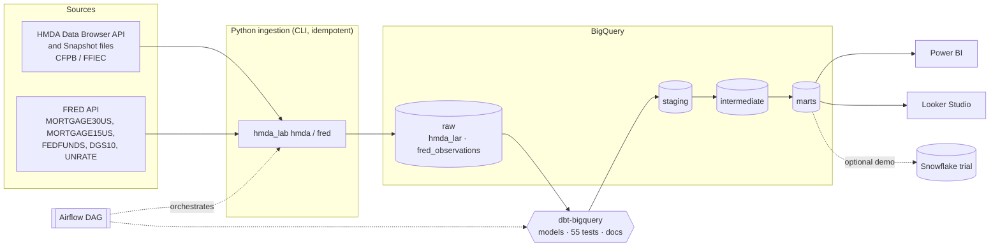

# HMDA Mortgage Ops Lab

A public, end-to-end analytics engineering lab on the U.S. mortgage market, built on
real public data: the **HMDA** loan/application register (CFPB/FFIEC, 2024-2025, ~25.8 M records)
and **FRED** interest-rate and macro series.

> Status: **Phase 1** — ingestion into BigQuery + dbt models and tests. Dashboards, orchestration,
> forecasting and an evaluated AI agent come in later phases (see [Roadmap](#roadmap)).

## Goal

Answer the questions a mortgage operations or market team asks every week, with reproducible code:

- What share of applications are approved or denied, by market, product and purpose?
- Why are applications denied (DTI, credit history, collateral, ...)?
- Who are the lenders in a market, and what is their share and pricing?
- How does loan pricing compare with the Freddie Mac PMMS benchmark and Treasury rates?

## Architecture



- **Raw** keeps HMDA values as text (`NA`, `Exempt`, `<20%` are valid values) and is
  partitioned by `activity_year` (integer range) and clustered by `state_code, lei, action_taken`.
- Loads are **idempotent**: each run loads into a scratch table, then deletes and re-inserts
  exactly the reloaded scope (year, and states if given) in one transaction.
- **dbt** types and documents the data, adds code descriptions (seeds), and builds marts.

## Stack

| Layer | Tool |
|---|---|
| Warehouse | Google BigQuery (free tier is enough for 2024-2025) |
| Optional demo | Snowflake (trial only, same dbt models, not required) |
| Ingestion | Python 3.11+ (`requests`, `google-cloud-bigquery`) |
| Transformation and tests | dbt Core + dbt-bigquery |
| Orchestration | Apache Airflow (DAG skeleton in phase 1) |
| BI | Power BI (main dashboard), Looker Studio (free public view) |

No AWS is used.

## Repository layout

```
ingestion/hmda_lab/   Python package + CLI (hmda, fred)
tests/                pytest unit tests with small fixtures (no network)
dbt/                  dbt project: staging, intermediate, marts, seeds, tests
airflow/dags/         Airflow DAG skeleton
docs/                 Notes and design docs
```

## Setup

```bash
python -m venv .venv && source .venv/bin/activate
pip install -r requirements-dev.txt
cp .env.example .env            # fill GCP_PROJECT_ID, BQ_DATASET, credentials, FRED_API_KEY
export PYTHONPATH=ingestion

# 1) See the plan without touching the network or BigQuery
python -m hmda_lab --dry-run hmda --years 2024 2025 --states DE
python -m hmda_lab --dry-run fred

# 2) Load a small state first, then nationwide from the snapshot files (~0.6 GB zip per year)
python -m hmda_lab hmda --source api --years 2024 2025 --states DE
python -m hmda_lab hmda --source snapshot --years 2024 2025
python -m hmda_lab fred --start 2018-01-01

# 3) Transform and test
cp dbt/profiles.example.yml ~/.dbt/profiles.yml
cd dbt && dbt seed && dbt build && dbt docs generate

# Unit tests (offline)
pytest
```

Credentials: a GCP service account with *BigQuery Data Editor* and *BigQuery Job User*
on the project. Never commit the key; `.env` and `*.json` keys are git-ignored.

## Data sources and licenses

| Source | What | Link | Terms |
|---|---|---|---|
| HMDA public LAR (CFPB / FFIEC) | Loan-level mortgage applications reported under the Home Mortgage Disclosure Act, 2024 and 2025 | [Data Browser API](https://ffiec.cfpb.gov/documentation/api/data-browser/) · [Snapshot 2025](https://ffiec.cfpb.gov/data-publication/snapshot-national-loan-level-dataset/2025) · [Data fields](https://ffiec.cfpb.gov/documentation/publications/loan-level-datasets/lar-data-fields) | U.S. federal government public data, published for public use. Several fields are modified or removed by the agencies to protect applicant privacy. This repo does not redistribute the full files; it downloads them from the source. |
| FRED (Federal Reserve Bank of St. Louis) | MORTGAGE30US, MORTGAGE15US, FEDFUNDS, DGS10, UNRATE | [FRED API](https://fred.stlouisfed.org/docs/api/fred/) · [Terms of use](https://fred.stlouisfed.org/legal/) | Free API key required. MORTGAGE30US and MORTGAGE15US come from the Freddie Mac Primary Mortgage Market Survey® and are copyrighted by Freddie Mac; cite the source. Other series are from U.S. government sources (Federal Reserve, Treasury, BLS). |

Required attribution: *"This product uses the FRED® API but is not endorsed or certified by the
Federal Reserve Bank of St. Louis."* Source of mortgage rates: *Freddie Mac, Primary Mortgage
Market Survey®, retrieved from FRED.*

The code is MIT-licensed (see `LICENSE`). Analyses describe aggregate market patterns and must not
be used to identify individuals or make credit decisions.

### HMDA field names

Column names follow the FFIEC public LAR data dictionary (`activity_year`, `lei`, `derived_msa-md`,
`action_taken`, `loan_amount`, `interest_rate`, `rate_spread`, `denial_reason-1..4`, ...). Hyphens
are replaced by underscores when loading (`denial_reason-1` → `denial_reason_1`,
`derived_msa-md` → `derived_msa_md`). Public HMDA has no application or action date, so pricing
is compared with FRED at the annual (`activity_year`) grain.

## Key definitions

- **Decisioned application**: `action_taken` in 1 (originated), 2 (approved, not accepted), 3 (denied).
- **Approval rate** = (1 + 2) / decisioned. **Denial rate** = 3 / decisioned.
- Purchased loans (6) and preapproval requests (7, 8) are excluded from rate marts.

## Roadmap

1. **Phase 1 — Warehouse and models (this release):** HMDA 2024-2025 and FRED into BigQuery, dbt
   staging → intermediate → marts, 50+ data tests, dbt docs.
2. **Phase 2 — Market dashboards:** Power BI (lender share by MSA, denial reasons, product mix)
   and a public Looker Studio view.
3. **Phase 3 — Orchestration and history:** Airflow in Docker, 2018-2023 backfill, CI/CD with
   GitHub Actions, infrastructure as code.
4. **Phase 4 — Forecasting and denial risk:** volume by MSA with FRED rates; a denial classifier
   with explanations and a fairness review.
5. **Phase 5 — Evaluated AI agent:** natural-language questions over the semantic layer, with
   generated SQL, cited answers and evals.
6. **Optional:** run the same dbt project on a Snowflake trial and document it.
